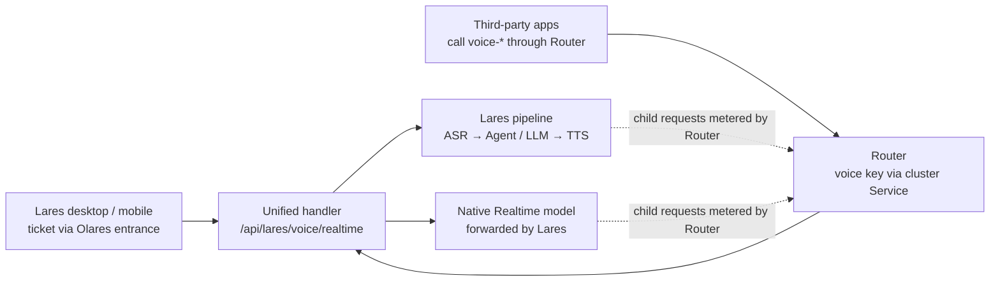

# Lares Realtime protocol (`lares-realtime-v1`)

Status: implemented except full-duplex acceptance; see
[Implementation status](#implementation-status). Lares desktop and mobile use
it by default, and the voice setting `transport: "legacy"` keeps the earlier
pipeline endpoints in [Voice runtime](voice-runtime.md) until device acceptance.
Router's side is
[Router ADR-83](https://github.com/beclab/router/blob/main/ARCHITECTURE.md#adr-83),
which supersedes ADR-81.

## Overview

Lares exposes one voice session interface: a compatible subset of the OpenAI
Realtime WebSocket API, versioned `lares-realtime-v1`. Lares desktop, Lares
mobile and Router use the same handler; only authentication differs.



To Lares, Router is just another client holding a key. Lares's own child
requests go back to Router and are metered there.

It replaces three earlier interfaces:

| Current interface | Used by | Source |
| --- | --- | --- |
| Pipeline: HTTP `/session*` + private `/stream` WS + `/transcribe`, `/speak` | Desktop and mobile default | `core/voice/conversation.js`, `stream-gateway.js` |
| Native Realtime: `/realtime` WS (OpenAI events + `lares.*`) | Desktop and mobile, opt-in, off by default | `core/voice/realtime-gateway.js` |
| Composite bridge: `/bridge/realtime` (`olares-voice-ws-v1`, HMAC identity) | Router composite voice; removed, voice-key callers now use `lares-realtime-v1` | formerly `core/voice/composite-gateway.js` |

Design rules:

- Anything an OpenAI event can express uses the OpenAI event and field names.
- Semantics OpenAI lacks go into `lares.*` extension events. A standard client
  that ignores them can still hold a basic conversation.
- Unsupported capabilities return `error`; nothing is silently ignored.
- The backend (Lares ASR → Agent → TTS, or a forwarded native Realtime model)
  is invisible to clients.

Non-goals: SIP, replacing `instructions`, telephony audio formats. Tools a
device declares are a capability the owner grants per key; see
[Device tools](#device-tools). WebRTC is not in v1, but session and event semantics do not
depend on WebSocket, so WebRTC or a LiveKit room can be added later as a
second transport. See [Unsupported capabilities](#unsupported-capabilities-and-error-codes)
and [LiveKit Agents mapping](#mapping-to-livekit-agents).

## Endpoint and authentication

One endpoint: `GET /api/lares/voice/realtime?model=<model>`, WebSocket upgrade.

| Caller | Authentication | Entry |
| --- | --- | --- |
| Lares desktop and mobile | `POST /api/lares/voice/realtime/ticket` returns a single-use ticket valid for 30 s; connect with subprotocols `lares-voice, lares-ticket.<ticket>`. Browsers cannot set headers, so the ticket stays | Olares entrance; the platform has authenticated the user |
| Router and other server-side callers | `Authorization: Bearer <lares voice key>` | The `webhook-internal` app entrance (`authLevel: internal`, port 8081), published at `<appid>1.<user zone>`. The per-user namespace's NetworkPolicy refuses direct Service traffic from shared apps |

Voice keys:

- The Lares owner issues and revokes keys in Lares settings. Only a hash is
  stored. A key is bound to a list of allowed models and may pin `sessionId` /
  `workspaceId`. `clientTools: true` lets its caller declare
  [device tools](#device-tools); keys default to `false`.
- The caller identity is the key owner. Identity headers such as
  `x-caller-appid` and `X-BFL-USER` are ignored.
- Router stores the key as an ordinary encrypted provider credential with base
  URL `https://<appid>1.<user zone>/api/lares/voice` (the `webhook-internal`
  entrance; for example `https://489966aa1.alice.olares.com/api/lares/voice`) and appends
  `/realtime?model=`. The 8081 listener forwards only that WebSocket path to
  this handler; everything else there stays the webhook API or 404.
- Access control on Router's side (model allowlists, quotas) belongs to Router.
  Lares neither knows nor cares who is behind Router.

The model name selects the preset and session type:

| `model` | Preset | `session.type` | Drives the personal Agent |
| --- | --- | --- | --- |
| `voice-dictation` | dictation | `transcription` | No |
| `voice-chat` | chat | `realtime` | No; conversation only |
| `voice-assistant` | assistant | `realtime` | Yes |
| `voice-direct` | direct | `realtime` | Yes |

`voice-assistant` and `voice-direct` operate the personal Agent as the owner.
Keys exclude them by default; issuing a key must select them explicitly, and
Router should expose them only to the owner.

## Session model

One WebSocket connection is one session. The server sends `session.created`;
the client may send `session.update`; the server confirms with
`session.updated`. Do not send audio before `session.updated`.

The model fixes one of two session types; `session.update` cannot switch them:

- **`realtime`**: speech in, speech or text out. Lares transcribes each user
  turn and hands it to the Agent (assistant / direct) or the dialogue model
  (chat), then synthesizes the reply.
- **`transcription`**: recognition only, no responses. Matches the OpenAI
  transcription session. Optional faithful cleanup never executes instructions.

Configurable `session.update` fields (anything else returns `error`):

| Field | Values | Notes |
| --- | --- | --- |
| `audio.input.format` | `{type:"audio/pcm", rate:24000}` | 24 kHz mono PCM16 only |
| `audio.output.format` | Same | `realtime` sessions only |
| `audio.input.turn_detection` | `null` or `{type:"server_vad", silence_duration_ms?}` | `null` = manual commit; `silence_duration_ms` 200–3000, default 500. `type` is extensible (for example a future `lares.turn_detector`); unknown types return an error |
| `audio.input.transcription.language` | BCP-47, such as `zh`, `en` | Optional; auto-detected when omitted |
| `audio.output.voice` | Lares voice ID | Optional; unknown voices return an error |
| `output_modalities` | `["audio"]` or `["text"]` | `["text"]` disables read-aloud and still returns text |
| `instructions` | String, ≤ 2000 characters (≤ 8000 for a device-tools key) | chat, or chat / assistant on a device-tools key; appended after Lares system policy, never replacing it. Rejected otherwise |
| `tools`, `tool_choice` | Realtime function tools; `"auto"` or `"none"` | Device-tools keys only, see [Device tools](#device-tools); any other caller gets `unsupported_parameter` |
| `lares.context_id` | Opaque string | Resumes the same owner's history; only before the first turn |
| `lares.echo_cancellation` | Boolean, default `true` | Whether the client cancels echo; see [Turns, interruption and truncate](#turns-interruption-and-truncate) |
| `lares.busy_turn` | `"queue"` or `"steer"` | Optional override for a user turn arriving while the Agent runs. Defaults to the owner's saved busy-Enter preference (`core/larepass/submission-settings.js`); idle turns always queue |

`session.created` / `session.updated` additionally carry
`session.lares.capabilities`. Clients decide from it instead of hard-coding.
The current build sends `"message_truncation":"none"`; the target below is
`"played"` once truncate lands:

```json
{"protocol":"lares-realtime-v1","transport":"websocket","barge_in":false,"playback_ack":true,"message_truncation":"played","turn_detection":["manual","server_vad"],"user_transcription":true,"context_resume":true,"client_tools":false}
```

The current `voice_context_id` and `capabilities` fields move under the
`lares.` prefix so they cannot collide with future OpenAI fields.

## Client events

Any OpenAI client event not listed returns `error` with code
`unsupported_event`.

| Event | Supported | Difference from OpenAI |
| --- | --- | --- |
| `session.update` | Yes | Only the fields in [Session model](#session-model) |
| `input_audio_buffer.append` | Yes | ≤ 64 KB base64 per event, ≤ 60 s per turn. In half-duplex, sending before playback is acknowledged returns `waiting_for_playback` |
| `input_audio_buffer.commit` | Yes | Ends a user turn in manual mode; returns `turn_busy` while the previous turn is still running |
| `input_audio_buffer.clear` | Yes | Drops uncommitted audio |
| `response.cancel` | Yes | Stops generation and synthesis of the current reply. It does **not** cancel background Agent tasks; use `lares.task.cancel` |
| `conversation.item.truncate` | Yes | `audio_end_ms` must be the position the client actually played |
| `response.create` | Partial | Empty parameters only: speaks the last reply again without resubmitting anything to the Agent, so a retry never repeats side effects. `instructions`, `tools`, `input` and similar parameters return an error. In a device-tools session it asks for a reply instead, as in OpenAI |
| `conversation.item.create` | Partial | Only `role:"user"` `input_text`, equivalent to saying a sentence in text. No assistant / system messages. A device-tools session also takes `function_call_output` and `input_image`, and its items only add context |
| `conversation.item.delete`, `conversation.item.retrieve` | No | Lares owns history |
| `output_audio_buffer.clear` | No | WebRTC only |

Client events may carry `event_id`; the server echoes it in the matching
`error`, as OpenAI does.

## Server events

The server sends only the OpenAI events below, with OpenAI GA Realtime field
names and order. A standard OpenAI client handling only these can complete a
conversation.

| Event | When | Difference |
| --- | --- | --- |
| `session.created`, `session.updated` | After connect / update | Also carry `lares.capabilities`, `lares.context_id` |
| `input_audio_buffer.speech_started`, `speech_stopped` | server_vad detects start / end | Energy endpointing against the room's noise floor, not semantic_vad. Before speech only about 300 ms of pre-roll is kept, and a take that reaches 60 s is committed rather than refused |
| `input_audio_buffer.committed`, `cleared` | After commit / clear | None |
| `conversation.item.input_audio_transcription.delta` | Streaming ASR has partial results | Optional, depends on the ASR model |
| `conversation.item.input_audio_transcription.completed` | Recognition done | Final result in transcription sessions; cleaned text when cleanup ran |
| `conversation.item.input_audio_transcription.failed` | A device take ASR could not read | Device mode only, in place of an `error`: the take is dropped and listening goes on. Other clients still get `error` |
| `conversation.item.done` | User / assistant item finalized | None |
| `response.created` | Reply starts | `response.metadata.lares.origin` is `turn` (answering the user) or `task` (announcing a finished Agent task) |
| `response.output_item.added`, `output_item.done` | Assistant item starts / ends | None |
| `response.output_audio.delta`, `.done` | Audio chunks | PCM16 24 kHz, ≤ 0.5 s per chunk |
| `response.output_audio_transcript.delta`, `.done` | Text for the audio | Per sentence, not per token |
| `response.output_text.delta`, `.done` | With `output_modalities:["text"]` | Same |
| `response.done` | Reply ends | `status` is `completed` / `cancelled` / `failed`; see [Usage and billing](#usage-and-billing) for `usage` |
| `conversation.item.truncated` | After truncate applies | None |
| `error` | Any failure | See [error codes](#unsupported-capabilities-and-error-codes) |

Never sent: `rate_limits.updated`, `output_audio_buffer.*` (WebRTC only), and
`response.function_call_arguments.delta`. Agent-internal tool calls are not
exposed as function calls; only calls to [device tools](#device-tools) are.

## Lares extension events

Three groups only: playback acknowledgement, Agent tasks and host device. When
a standard client sends no playback acknowledgement, the server assumes it plays
what it was sent in real time; `response.cancel` or `conversation.item.truncate`
from the client ends that estimate, and truncate stays approximate. What the
server does with the microphone meanwhile depends on the client's
[listening mode](#listening-modes).

| Event | Direction | Fields | Replaces |
| --- | --- | --- | --- |
| `lares.playback.progress` | Client → server | `item_id`, `played_ms` | New, about every 250 ms |
| `lares.playback.completed` | Client → server | `item_id` | `voice.playback.completed` |
| `lares.task.updated` | Server → client | `task_id`, `status` (`pending` / `running` / `completed` / `failed` / `cancelled` / `unknown`), `session_id`, optional `summary` | `lares.task` |
| `lares.task.cancel` | Client → server | `task_id` | HTTP `/session/cancel` |
| `lares.device.input.pause` / `.resume` | Client → server | None | `lares.input.pause` / `.resume` |
| `lares.device.playback` | Server → client | `playing` | `lares.playback` |
| `lares.playback.timeout` | Server → client | — | Playback acknowledgement watchdog expired |

Other current `lares.*` events become standard events: `lares.ready` →
`session.created`, `lares.error` → `error`, `lares.output` → `session.update`
`output_modalities`.

Agent tasks follow LiveKit's asynchronous tools:

- **Before acceptance**: until the server sends `lares.task.updated`
  (`pending`), the task belongs to the current reply. A user interruption
  cancels the turn, including withdrawing a submitted task. When dsh cannot
  withdraw it, the task counts as accepted immediately.
- **After acceptance**: the server confirms briefly with an ordinary response
  and sends `lares.task.updated` (`pending`). The task now runs in the
  background; interruption stops speech only.
- **Explicit cancellation**: the client sends `lares.task.cancel`, or the user
  says something like "cancel that" and the server recognizes the intent. Tasks
  declare whether they are cancellable; otherwise the error is
  `task_not_cancellable`.
- **Duplicates**: submitting the same task while it runs tells the user it is
  already in progress instead of submitting again.
- **Progress**: when `lares.task.updated` carries `summary`, the server may
  announce progress while idle, saying only what the summary contains.
- **Result**: once the user is silent and nothing is playing, the server sends
  an `origin: task` response with the result, without repeating what was
  already said.
- **Session close**: tasks are not cancelled; results stay in the Lares
  session. This is the one deliberate difference from LiveKit, whose tools live
  in the session process. Lares tasks are durable dsh tasks visible in chat.

Host device mode: the Olares host microphone and speaker (including Bluetooth)
capture and play audio; no audio crosses the WebSocket. Only ticket-based Lares
clients can enable it, by requesting `device:"host"` for the ticket. Voice key
callers cannot.

## Device tools

A device such as a robot can declare tools that run on the device itself, the
way an OpenAI Realtime client does. Only a key issued with `clientTools: true`
may, and only on `voice-chat` or `voice-assistant`, whose voice dialogue model
answers first. Ticket sockets and other keys keep the behaviour above, and
`session.lares.capabilities.client_tools` says which applies.

- **Declaring.** `session.update` takes `tools` (≤ 64 functions, unique names,
  never `ask_lares`) and `tool_choice` (`"auto"` or `"none"`). The dialogue
  model sees them beside `ask_lares` and is told to call them directly.
- **Calls.** A response may carry a spoken message and function calls. Calls
  are sent first (`response.output_item.added` of type `function_call`, then
  `response.function_call_arguments.done` and `response.output_item.done`), so
  a gesture can accompany its words. `response.done` lists them in `output`.
- **Results.** The device sends `conversation.item.create` with a
  `function_call_output` for the same `call_id`, and `response.create` when it
  wants the model to go on. A tool that needs no follow-up sends only the
  output. A camera frame goes in a user message with one `input_image` data URL
  (JPEG, PNG or WebP, under 512 KB), and only the newest frame stays in context.
- **Item semantics.** In these sessions `conversation.item.create` only adds
  context, and `response.create` starts a reply, queued while a turn is still
  running. Spoken turns still reply on their own.
- **Limits.** At most 8 calls per response. After three continuations without
  new user input the model must answer in words. A call that never gets an
  output is recorded as failed when the next step starts, and a late output for
  it is ignored.
- **Agent results.** In these sessions a finished `ask_lares` task is not read
  out verbatim. The dialogue model announces it and may call device tools as it
  does, or stay silent if it already said everything.
- **Delegation.** `ask_lares` hands the Agent the user's transcript first,
  followed by the dialogue's restatement, so a follow-up such as a bare city
  name keeps the context earlier turns settled.

Device calls and their outputs live only in the dialogue context. They are not
written to Lares session records.

## Listening modes

Lares's own clients and a device speak the same protocol but listen in
different ways, and the server applies each rule to one mode only
(`core/voice/listening.js`).

| Mode | Who | How a take ends | While a reply plays |
| --- | --- | --- | --- |
| Push-to-talk | Lares phone (hold, release) and desktop (tap, tap again) | The client commits (`turn_detection: null`) | Half duplex: the client reports playback and does not send audio |
| Hands-free | Lares headset, continuous | `server_vad`, with playback reports | Half duplex, unless `LARES_VOICE_BARGE_IN=1` turns on suspend-and-resolve barge-in |
| Device | A robot that hears its room all the time: `server_vad`, no playback reports | `server_vad` against the room's noise floor; a take closes after 10 s at most; Router's VAD (`default-vad`) drops a take with no speech before ASR | **Full duplex**: speech that stands out from the reply's echo for 500 ms is checked by Router's VAD. Only a person sends `input_audio_buffer.speech_started`, which the device takes as "stop playing". The reply is truncated to what was heard, and the speech becomes the next turn |

A device that sets `lares.echo_cancellation: false` cannot tell its own reply
from the user, so it stays half duplex: input is dropped quietly until the
reply has played, plus about 400 ms of room echo. When Router's VAD cannot
answer, a take or a barge-in goes through as if it held speech. A take Router's
VAD finds empty also teaches the device's noise gate the room's level, even
above the usual widest floor, so a loud fan or a microphone's gain stops
reading as a voice that never ends.

Every session holds at most one ASR request at a time: a take that starts
while the previous one is still being transcribed is buffered and streamed
once that finishes. When Router answers that the ASR model is busy (503 or
429), the stream handshake and the batch fallback each retry after 0.4 s and
1.2 s before the take fails.
`session.lares.capabilities.barge_in` reports whether the session can be
interrupted.

## Turns, interruption and truncate

v1 is half-duplex. The protocol already reserves full-duplex interruption;
`lares.capabilities.barge_in` says which one is active.

Turn rules:

1. Manual mode (`turn_detection: null`): the client appends audio and `commit`
   ends the turn.
2. server_vad mode: silence longer than `silence_duration_ms` commits
   automatically and emits `speech_stopped` and `committed`.
3. Only one user turn is processed at a time. A commit that arrives while the
   previous take is still being transcribed or submitted is queued and
   processed next; its audio is buffered meanwhile. `turn_busy` only reports a
   full queue (typed messages) rather than ordinary microphone contention.

**Half-duplex (`barge_in: false`)**: during reply playback the server rejects
`append` (`waiting_for_playback`) until `lares.playback.completed`. A reply that
receives no acknowledgement and no progress for 60 s releases the gate and emits
the diagnostic `lares.playback.timeout`, so a vanished client cannot leave the
connection wedged. Only the client can interrupt: stop local playback →
`response.cancel` → `conversation.item.truncate`.

**Full-duplex (`barge_in: true`, later)**: `append` is accepted during
playback. When server_vad hears the user, the server emits `speech_started`,
cancels the current response and truncates at the latest `played_ms`, as OpenAI
does. This requires client echo cancellation so the speaker output is not sent
back.

Interruption policy is server-side and not part of the protocol: minimum
interruption duration, minimum words, resuming after false interruptions and
ignoring backchannels ("mm", "right"). Clients see only standard
`speech_started`, `response.cancel` and `truncated`. After a false
interruption, the server continues the same response's audio and does not send
`response.done`.

Hold-to-talk needs no extra events:

| Client gesture | Protocol |
| --- | --- |
| Press | Manual mode (`turn_detection: null`), start `append` |
| Release | `input_audio_buffer.commit` |
| Slide-up cancel, blur, background, multi-touch | `input_audio_buffer.clear` |
| Press during reply playback | `response.cancel` and `conversation.item.truncate`, then `append` |
| Keyboard return (pause voice, keep the Agent running) | `response.cancel`, which never cancels tasks |
| Live preview while holding | Server `conversation.item.input_audio_transcription.delta` |

Cancel-armed and preview visibility are UI state and never cross the wire.

Clients without AEC declare `lares.echo_cancellation: false` in
`session.update`; the server falls back to half-duplex for that session.

Truncate rules:

- `audio_end_ms` is what the user actually heard, not what the client received.
  Values beyond the sent audio are clamped to the sent duration.
- The server cuts assistant text at sentence boundaries. The cut part enters
  neither the Agent context nor Lares history.
- Clients that never sent `lares.playback.*` may truncate, but only to sentence
  precision.

## Usage and billing

The Lares session itself costs nothing; all cost sits in the ASR, LLM and TTS
child requests Lares makes. `response.done.usage` is always an all-zero object,
and actual usage is in `response.metadata.lares.usage`:

```json
{"billing":"child-models","input_audio_ms":4200,"output_audio_ms":6100}
```

The zero `usage` keeps the OpenAI shape so SDKs that expect it parse normally:

```json
{"total_tokens":0,"input_tokens":0,"output_tokens":0,"input_token_details":{"text_tokens":0,"audio_tokens":0,"cached_tokens":0},"output_token_details":{"text_tokens":0,"audio_tokens":0}}
```

Tokens are not estimated from child requests: an estimate would make Router
charge the same inference twice. Router distinguishes "cost in child requests"
from "usage lost" by model metadata, not by `usage`.

Router settlement rules (Router ADR-83):

- With `extensions.voice_service.billing = "child-models"`, all-zero `usage`
  is expected and is not flagged `metering_incomplete`.
- Each `response.done` writes one zero-cost record tagged `composite_voice` and
  `usage_in_child_models`, deduplicated by response ID.
- Child requests call Router as Lares itself and are metered normally under the
  Lares owner.
- Quota: Router's quota for the caller governs only whether a session may open
  and how long it runs, not child request spend. The Lares owner's own quota
  bounds that.

Tracing reuses Router's existing caller-supplied `X-Session-Id`, which Router
writes to `spend_logs.session_id`. Router sends its realtime session ID as
`X-Session-Id` when dialing, and Lares sends the same value on every child
request of that session, so the composite record and its child requests group
under one session. No new header is introduced.

## Unsupported capabilities and error codes

None of these affect Lares's main scenarios. Callers that need them should use
a native Realtime model directly.

| Capability | Why not |
| --- | --- |
| Client-defined `tools` without the device-tools grant | The Lares Agent provides tools; a caller's tools must not drive the personal Agent unless the owner granted it |
| Replacing `instructions`, injecting assistant / system history | Would bypass Lares policy and session records |
| `semantic_vad` | v1 has server_vad only; `turn_detection.type` is extensible for a turn detector model later |
| WebRTC, SIP, sideband | v1 is WS only; WebRTC / LiveKit room can be a later transport with the same events. No SIP or sideband |
| g711 and other formats, rates other than 24 kHz | Telephony, unrelated to Lares |
| Full-duplex interruption | Not in v1; reserved, see [Turns, interruption and truncate](#turns-interruption-and-truncate) |

Errors use the OpenAI `error` event, with `error.type` `invalid_request_error`
or `server_error` and `error.code` from the table. Connection errors return an
HTTP status during upgrade.

| `error.code` | Type | Meaning | Current name |
| --- | --- | --- | --- |
| HTTP 401 | Connection | Invalid or revoked key or ticket | `voice_external_unauthorized` |
| HTTP 403 | Connection | Key does not include the model | `voice_external_forbidden` |
| HTTP 429 | Connection | Too many concurrent sessions (currently 64) | `voice_external_limit` |
| HTTP 503 | Connection | Voice service disabled or dependency model unavailable | `voice_external_disabled` |
| `unsupported_event` | invalid_request | Event type not supported | `voice_event_unsupported` |
| `unsupported_parameter` | invalid_request | Unsupported field in `session.update` or `response.create` | `voice_session_forbidden` and others |
| `unsupported_audio_format` | invalid_request | Not pcm16 / 24 kHz, or invalid base64 | `voice_audio_format` |
| `audio_limit_exceeded` | invalid_request | Event or turn audio over limit | `voice_audio_limit` |
| `waiting_for_playback` | invalid_request | Half-duplex reply not yet played | `voice_waiting_for_playback` |
| `turn_busy` | invalid_request | Previous turn still running | `voice_turn_busy` |
| `context_locked` | invalid_request | `lares.context_id` changed after a turn | `voice_context_locked` |
| `task_not_cancellable` | invalid_request | Task does not allow cancellation | New |
| `recursive_model` | server | A Lares dependency model points back to `voice-*` | `voice_recursive_model` |
| `upstream_failed` | server | Child request (ASR / LLM / TTS) failed | `voice_failed` |

On idle timeout (default 5 minutes without speech) or missed heartbeat (15 s
ping), the server sends `error` with `code: session_expired` and then closes.

## Mapping to LiveKit Agents

The protocol defines only the wire format. Turn taking, interruption and
synthesis scheduling in LiveKit Agents correspond to Lares server internals and
can keep evolving from it. Paths are relative to `agents-js/agents/src/`; the
Python package `agents/livekit-agents/livekit/agents/` has equivalent modules
with a slightly different file layout.

| LiveKit Agents | Defaults / key points | Lares | Status |
| --- | --- | --- | --- |
| `AgentSession` + STT–LLM–TTS pipeline (`voice/agent_session.ts`) | One session, interchangeable backends | Lares pipeline backend | Exists |
| `RealtimeModel` / `RealtimeSession` (`llm/realtime.ts`) | Interchangeable with the pipeline | Native Realtime backend | Exists, off by default |
| `RealtimeCapabilities` | `messageTruncation`, `turnDetection`, `userTranscription`, `supportsOverlappingSpeech`, `audioOutput` | `lares.capabilities` | Fields named after these semantics |
| `TurnDetectionMode` (`stt` / `vad` / `realtime_llm` / `manual` / turn detector model) | Semantic end-of-utterance model | `turn_detection`: `null` / `server_vad` / extension types | manual and vad only |
| `EndpointingOptions` (`voice/turn_config/endpointing.ts`) | `minDelay` 500 ms, `maxDelay` 3000 ms, fixed / dynamic | `silence_duration_ms` | Fixed delay only |
| `InterruptionOptions` (`voice/turn_config/interruption.ts`) | `minDuration` 500 ms, `minWords`, `falseInterruptionTimeout` 2000 ms, `resumeFalseInterruption`, `backchannelBoundary` | Server interruption policy | Not done |
| `PreemptiveGenerationOptions` | Generate before the user finishes, `maxSpeechDuration` 10 s | Server internal | Not done; chat only, since Agent tasks have side effects |
| Playback position → `realtimeSession.truncate({audioEndMs})` (`voice/agent_activity.ts`) | Truncate at actual playout | `lares.playback.progress` + `conversation.item.truncate` | Aligned |
| `TranscriptionSynchronizer` (`voice/transcription/synchronizer.ts`) | Sync text with audio | Client displays by `played_ms` | Reference |
| `text_transforms`, TTS stream adapter / pacer | Markdown cleanup, sentence synthesis, pacing by remaining audio | `speechSegments`, sentence synthesis | Referenced |
| `room_io` (WebRTC room transport) | Opus, jitter handling, browser AEC | WebSocket transport | v1 WS only; semantics transport-independent |

Agent tasks correspond to LiveKit's asynchronous tools (`voice/tool_executor.ts`)
and behave the same way. A LiveKit tool is aborted with an interruption until
its first `ctx.update`; afterwards it detaches from the reply, interruptions no
longer affect it, and only `lk_agents_cancel_task` cancels it (the tool must
carry the `CANCELLABLE` flag). Progress, duplicate handling and announcing
results when idle without repetition also correspond (`UPDATE_TEMPLATE`,
`onDuplicate`, `REPLY_INSTRUCTIONS_MAYBE_COVERED`). The only difference is that
Lares keeps tasks after the session closes; see
[Lares extension events](#lares-extension-events). Preemptive generation stays
chat-only: submitting a task before the user finishes could trigger an
unwanted action.

## Implementation status

| Area | State |
| --- | --- |
| Voice keys (`core/voice/keys.js`), settings UI on desktop and mobile | Live |
| One handler for Bearer keys and Lares tickets (`core/voice/lares-realtime-gateway.js`); native-backend tickets forward to Router through `realtime-gateway.js`, which speaks the same events | Live |
| Session types, `session.update` fields, client and server events, `lares.*` extensions | Live |
| Sentence-level truncate, chat `instructions`, `response.create`, item events, streaming transcription deltas (models with `stt_stream`) | Live |
| Device tools on `clientTools` keys: declared tools, function call events, outputs, camera frames, announcements through the dialogue | Live |
| Per-task withdraw and cancel through the dsh queue; busy turns follow the owner's busy-Enter preference | Live |
| `X-Session-Id` on ASR, TTS, dialogue and Agent model calls | Live; dsh sends its session id and the `/llm/v1` shim swaps in the Realtime one while a keyed session drives it |
| Host headset mode on ticket sockets | Live |
| Lares desktop and mobile clients (`core/voice/unified-conversation.js`) | Live by default; `transport: "legacy"` keeps the pipeline endpoints |
| Full-duplex barge-in | Device mode: live, confirmed by Router's VAD. Lares clients: code present; off unless `LARES_VOICE_BARGE_IN=1` and the client reports echo cancellation |
| Removal of the pipeline session endpoints | After device acceptance (step 5) |

Deployment gate: Router reaches Lares only through the internal entrance on
8081, which the webhook listener serves. Probe it from router-shared before
registering the provider.

## Migration plan

Merge the server first, then migrate clients, then delete old interfaces. Each
step ships independently; old interfaces stay available until step 5.

1. **Lares: unified handler.** *Done.* Bearer keys and pipeline tickets share
   `lares-realtime-gateway.js`; native-backend tickets keep the forwarding
   gateway with the same client events.
2. **Lares: voice keys.** *Done.* Issue and revoke keys in settings, replacing the
   `LARES_VOICE_ROUTER_SECRET` and `LARES_VOICE_EXTERNAL_GRANTS` environment
   variables.
3. **Router: Bearer for composite voice.** *Done (beclab/router#147).* Remove the HMAC identity signature
   in `compositeVoiceHeaders` and send the provider credential as
   `Authorization: Bearer`. Keep `extensions.voice_service` as the billing
   marker; all-zero `usage` is no longer flagged incomplete (Router ADR-83).
   Send the realtime session ID as `X-Session-Id` on the dial and stamp it on
   the composite record.
4. **Lares client migration.** *Done behind the `transport` setting.* `realtime-conversation.js` only needs event
   renames; the pipeline session in `conversation.js` and `stream-client.js`
   moves to the unified WS. Desktop and mobile share one protocol client in
   `@olares/lares-core`.
5. **Delete old interfaces.** `/bridge/realtime` is already gone. Remove the old private
   `/realtime` events and pipeline HTTP control endpoints such as
   `/session/prompt`. `/transcribe`, `/speak` and the `/stream` TTS that reads
   existing replies aloud are not sessions and stay.
6. **Full-duplex interruption.** No protocol change; set `barge_in` to `true`
   after AEC and device validation.
