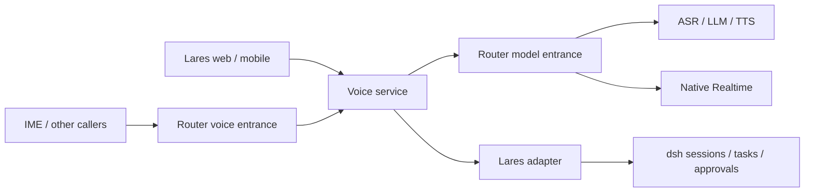
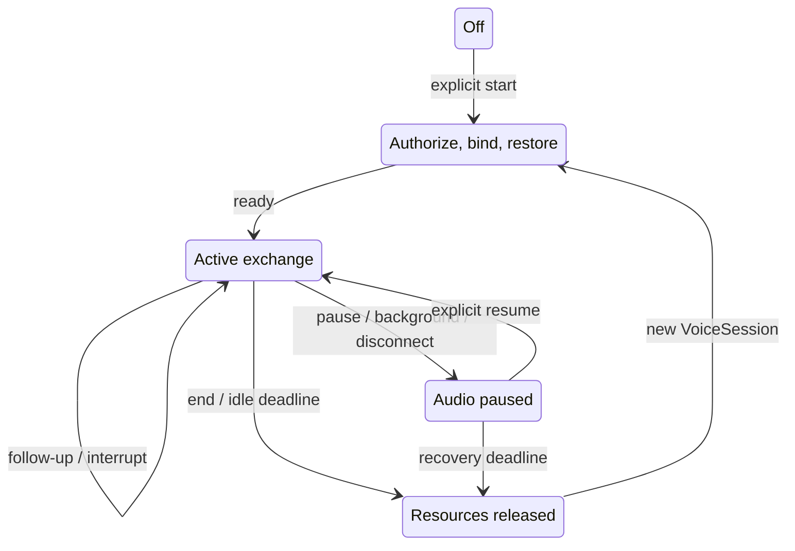
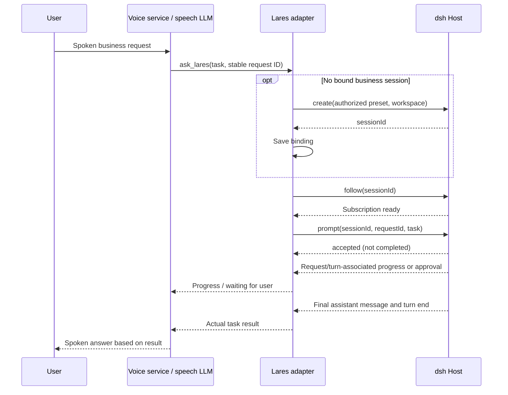
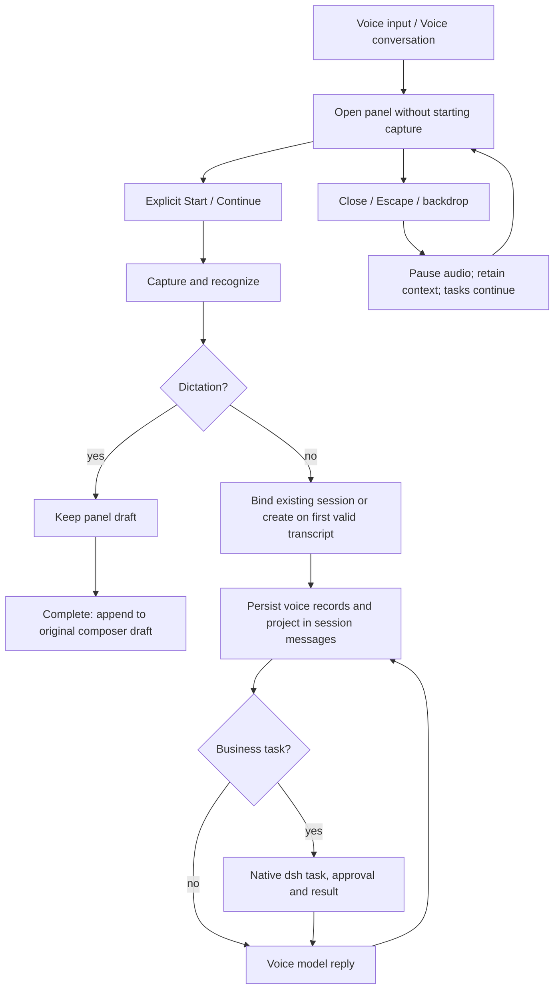

# Voice service design

Status: target design; capabilities become available only after implementation and acceptance. See [runtime](voice-runtime.md) for current behavior and [delivery plan](voice-service-plan.md) for progress.

## Boundaries

The service initially runs in the Lares process. Shared logic lives in `packages/core/voice`; Host adapters mount authenticated routes. No LiveKit Agent runtime is introduced. Lares/dsh owns durable tasks, skills, tools, approvals and business history. Router owns model discovery, authentication, routing, quotas and usage. SDKs own device capture, transport and playout reporting. Existing voice_input is not a mandatory dependency; its ordered transcript events, optional cleanup and capability negotiation are reference contracts.

Public voice model IDs must differ from dependency model IDs. Reject recursive service routing. Provider-native Realtime and cascaded speech are separate backends, not separate user interaction modes.

## Interaction and presets

| Preset | Behavior |
| --- | --- |
| dictation | ASR and optional faithful cleanup; return text, never execute an Agent |
| chat | Speech conversation without Lares |
| assistant | Speech LLM handles conversation and clarification; business lookups/actions delegate to Lares |
| direct | Every valid transcript enters dsh; read its response if enabled |

Continuous conversation uses either Router ASR + LLM + TTS or a validated native Realtime model. Server presets control models, instructions, voice, language, endpointing, interruptions, read-aloud and timeouts. Clients may override only allowlisted values. Business session/workspace/preset/tool permissions come from authenticated grants, never model arguments.

Web defaults to dictation, mobile to continuous conversation. Each exposes both explicit entries. Dictation returns editable text, preserving existing text and attachments, and sends only on user confirmation. Mobile continuous conversation starts on a tap, not a hold gesture. Read-aloud is independent of mode.

## Three lifecycles

An audio connection owns microphone, stream, playback and physical-device leases. A VoiceSession owns the live exchange, turn state, model connections and task associations. A Lares session owns persistent business history. IDs are correlation values, not credentials. Owner-scoped context handles permit explicit recovery across new VoiceSession IDs; they never replace user authorization. Transport recovery and business binding recovery are separate.

| Situation | VoiceSession | Lares session |
| --- | --- | --- |
| Next utterance during an active exchange | reuse | reuse |
| New device/client | independent | may explicitly share |
| Existing chat entry | create | bind selected chat |
| Standalone entry | create | lazy on first business delegation |
| Dictation / pure chat | lightweight / conversational | none |
| Explicit new chat | end and create | lazy new binding |
| Switch existing chat | stop old audio, discard unsubmitted input | bind target |
| Audio reconnect / backend rotation | resume or rebuild runtime | preserve |
| End and start again in same chat | new runtime | preserve |

Defaults: 300 seconds exchange idle, 120 seconds reconnect grace; both configurable. Background/lock stops capture and playout. No automatic microphone restart or historical audio replay. Background business tasks must not keep audio/model resources alive. Closing voice never implicitly cancels dsh work. Pause input discards unsubmitted input but can leave output running; background/disconnect pauses both.

## Context and records

Keep speech text records separately from dsh task messages, with owner, source client, voice session, turn, task association and append order. Never persist raw audio by default. Store a recoverable summary of topic, constraints, unresolved clarification and tasks; checkpoint after each turn. Following a crash, rebuild from committed text. Summaries carry source/version and must not overwrite concurrent client updates blindly.

Resume with the relevant summary and current task state, not a replay of all business history. Ambiguous references require clarification. Records are inspectable/clearable and deleted with their parent conversation. Independent chat records have their own owner and lifecycle. Dictation text is returned to the caller rather than automatically added to assistant history.

## Delegation contract

Track each request and associated dsh turn; session idle alone is never completion evidence. Verify queue and steer semantics against the installed dsh event contract. Source user messages fence ownership; another client's turn must never be read as this client's result. Keep unknown submissions deduplicated; reconnection checks the original request instead of issuing it again. Pending, approval, failure, cancellation and completion are distinct states. Long-running work permits further speech and survives audio closure. Voice cannot approve on the user's behalf. Exactly one path speaks each result.

## Protocol and safety

Expose create/close, audio input, commit/discard turn, pause/resume input, stop output, playout acknowledgement and typed events. Exactly one endpointing authority controls a connection. Reuse VAD and configurable pause thresholds initially; retain a semantic detector port. Detect interruptions independently of end-of-turn. Truncate conversational output only at acknowledged playout, never at bytes merely received.

Retain bounded queues, host exclusive leases and capability-based half-duplex behavior. Automatic barge-in remains disabled until actual echo tests pass. No stream may accumulate unbounded buffered audio. The composite protocol requires explicit playout-completed acknowledgement before accepting more half-duplex input; response generation completion alone is insufficient.

Router exposure initially implements an advertised Realtime WebSocket subset plus capabilities. WebRTC, SIP and arbitrary client tools are excluded. Applications without an authenticated user grant may use authorized dictation/chat but cannot delegate to a personal Lares session. An app ID or client-supplied user/session ID does not establish end-user authority. Scoped records, resume handles and grants must reject cross-user access.

Attribute composite service usage separately from child model usage; do not fabricate native token counts or count the same cost twice. Gate unvalidated models and transports. Failure must remain explicit, with no silent downgrade/re-execution.

## Acceptance

Test stale input, cancellation, session switching, multi-client shared tasks, queue/steer correlation, approvals, deduplication across uncertain outcomes, context recovery, backpressure and identity isolation. Run focused/full tests, typecheck and build. Verify real browser, iOS/Android, host and Bluetooth chains separately; report transcription, first text, first audio and interruption latency without logging transcripts or credentials as metrics. No deployment, push, PR or release version change is implicit.

## Voice panel and session message presentation

The composer exposes Voice input and Voice conversation entries only, plus a short paused indicator. Entries open one in-app panel with Dictation and Conversation tabs (full screen on mobile). The panel owns device, waveform, elapsed time, temporary transcription and audio controls; complete replies and history belong in the existing session message area. Switching tabs pauses capture/playback first and preserves dictation drafts; the user explicitly starts the next mode.

Panel visibility is independent of VoiceSession lifetime. Close, Escape and backdrop pause capture/playback while retaining conversation context and leaving dsh work running. Reopening only shows the panel; Continue explicitly resumes audio. Closing during dictation finishes recognition into a panel draft; it never inserts or sends automatically. Complete appends to the original session draft, preserving existing text and attachments. Discard removes only the panel draft. End voice releases resources without deleting records. Task cancellation stays in the chat area. Session changes pause the old exchange and fence late results to its original target.

Existing Lares sessions bind directly. On an empty Lares page, the first valid continuous transcript creates a presentation session without submitting an Agent prompt. Empty audio, noise and cancellation create nothing. Generic Voice Service clients retain their own binding policy.

Voice user/assistant records are read-only projections alongside native dsh chat nodes (mobile Transcript uses the same projection rules). Records are persisted independently, never synthesized as dsh execution events or resubmitted as prompts. Streaming updates replace the same stable record ID. Host ordering and persisted dsh sequence anchors provide stable interleaving after refresh and across clients. Historical records never trigger speech. Session-scoped authorized paginated reads and subscriptions are independent of an active VoiceSession; /records alone is insufficient.

Delegations correlate voiceId / turnId / requestId / taskId. Native dsh input/results take over corresponding temporary projections; spoken summaries are attached to the task result. Tool progress, approvals and cancellation use native chat components. Core owns panel lifecycle, drafts, binding and projection; React/Vue own presentation and devices.

