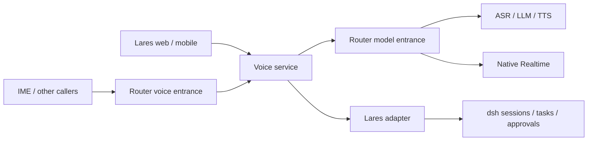
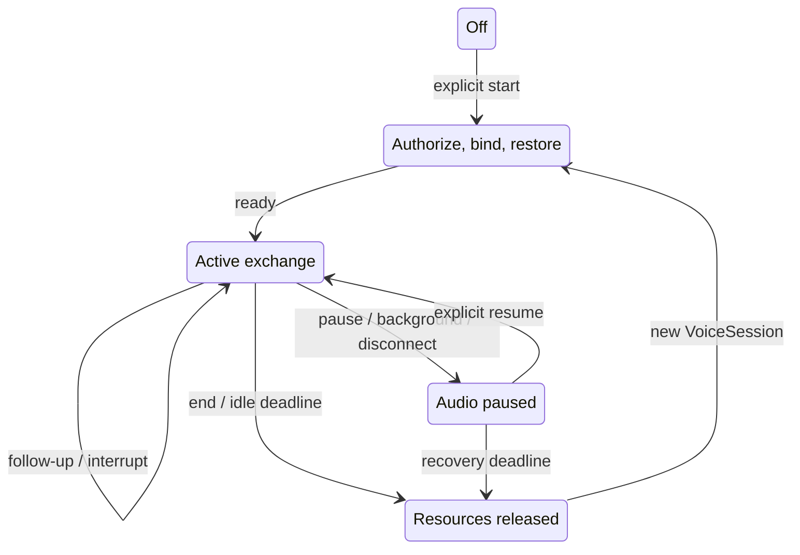
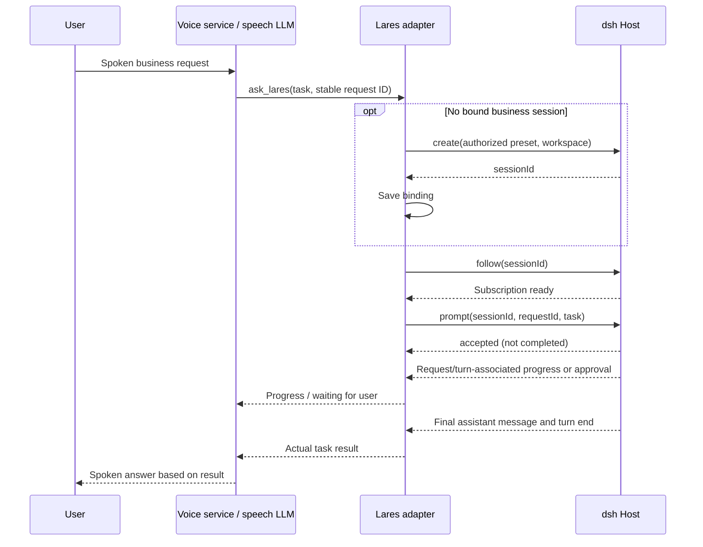
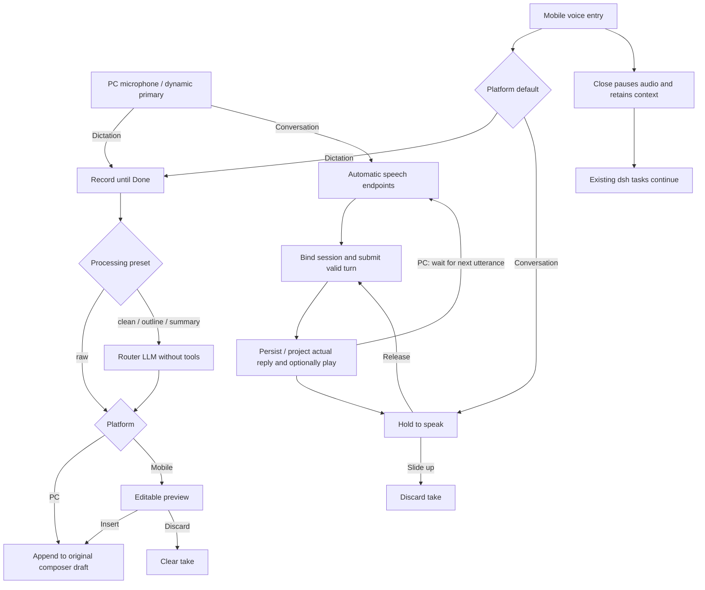

# Voice service design

Status: target design; capabilities become available only after implementation and acceptance. See [runtime](voice-runtime.md) for current behavior and [delivery plan](voice-service-plan.md) for progress.

## Boundaries

The service initially runs in the Lares process. Shared logic lives in `packages/core/voice`; Host adapters mount authenticated routes. No LiveKit Agent runtime is introduced. Lares/dsh owns durable tasks, skills, tools, approvals and business history. Router owns model discovery, authentication, routing, quotas and usage. SDKs own device capture, transport and playout reporting. Existing voice_input is not a mandatory dependency; its ordered transcript events, optional cleanup and capability negotiation are reference contracts.

Public voice model IDs must differ from dependency model IDs. Reject recursive service routing. Provider-native Realtime and cascaded speech are separate backends, not separate user interaction modes.

## Interaction and presets

### Lares product entries and generic API policy

Lares entries select their policy per connection. Dictation uses `preset: dictation` and `backend: pipeline`, returns processed text to the original draft, and never creates an Agent task. Conversation uses `preset: direct` and `backend: pipeline`: each valid transcript enters the bound dsh session with its current Agent model, permissions, skills and tools. PC retains two entries and automatic rounds; mobile retains its default entry and hold-to-speak. Starting, resuming or recreating either connection does not change global API defaults.

The generic Voice Service API still supports all four presets, independent dialogue models and validated native Realtime. `POST /api/lares/voice/session` accepts optional `preset` and validated `backend` overrides; omitted values retain configured defaults. An explicit Realtime override must pass the existing validated-model gate. Lares direct conversations do not construct the independent voice dialogue or run its reply/summary LLM. Their durable context remains in dsh.

Lares dictation requires ASR. Lares conversation requires ASR, TTS and a routable current Agent configuration; it does not require an independent voice-chat model. Settings expose ASR/TTS, language, devices, read-aloud, dictation processing profiles and mobile interaction preference. API preset, independent chat model, backend and native Realtime selection are absent from both product settings surfaces.

A single Dictation style selector offers raw, clean, outline and summary. The selected value is both the saved default and the configuration shown immediately below; there is no independent editor selection, preset list, Tab or disclosure. Raw shows only its no-LLM explanation; other profiles show model and six-line instructions. Switching automatically saves the selected style before replacing the editor, disables competing switches, and retains the previous selection on failure. Dirty profile changes require Save/Discard/Keep editing before switching or leaving; failed saves do not switch. Profile configurations remain independent, Reset only edits the draft, and Save/Cancel appear only for dirty model/instructions. Opening settings never changes the saved style.

Shortcut bindings are always expanded on the official web settings page. Vue shows them only for explicit `device="desktop"`, regardless of viewport width. Both clients share the recorder and unsaved-draft guard. LarePass hosts bind the settings component's optional `bindBeforeLeave(listener)` or await its exposed `beforeLeave()` before navigation; an arbitrary external unmount cannot be intercepted by Vue. Mobile hosts receive no system/global shortcut integration.

| Preset | Behavior |
| --- | --- |
| dictation | ASR and optional faithful cleanup; return text, never execute an Agent |
| chat | Speech conversation without Lares |
| assistant | Speech LLM handles conversation and clarification; business lookups/actions delegate to Lares |
| direct | Every valid transcript enters dsh; read its response if enabled |

Continuous conversation uses either Router ASR + LLM + TTS or a validated native Realtime model. Server presets control models, instructions, voice, language, endpointing, interruptions, read-aloud and timeouts. Clients may override only allowlisted values. Business session/workspace/preset/tool permissions come from authenticated grants, never model arguments.

PC exposes separate dictation and conversation actions; the saved web mode no longer chooses one entry's meaning. Mobile keeps its saved mode (conversation by default), hold/release turns and editable dictation preview. PC conversation uses automatic endpoints and waits for another utterance after replies; PC dictation appends to the editable composer without a separate preview. Neither dictation path submits an Agent task. Read-aloud remains a separate preference.

## Three lifecycles

An audio connection owns microphone, stream, playback and physical-device leases. A VoiceSession owns the live exchange, turn state, model connections and task associations. A Lares session owns persistent business history. IDs are correlation values, not credentials. Owner-scoped context handles permit explicit recovery across new VoiceSession IDs; they never replace user authorization. Transport recovery and business binding recovery are separate.

| Situation | VoiceSession | Lares session |
| --- | --- | --- |
| Next utterance during an active exchange | reuse | reuse |
| New device/client | independent | may explicitly share |
| Existing chat entry | create | bind selected chat |
| Standalone entry | create | lazy on first business delegation |
| Dictation / pure chat | lightweight / conversational | none |
| Explicit new chat | end and create | lazy new binding |
| Switch existing chat | stop old audio, discard unsubmitted input | bind target |
| Audio reconnect / backend rotation | resume or rebuild runtime | preserve |
| End and start again in same chat | new runtime | preserve |

Defaults: 300 seconds exchange idle, 120 seconds reconnect grace; both configurable. Background/lock stops capture and playout. No automatic microphone restart or historical audio replay. Background business tasks must not keep audio/model resources alive. Closing voice never implicitly cancels dsh work. Pause input discards unsubmitted input but can leave output running; background/disconnect pauses both.

## Context and records

Keep speech text records separately from dsh task messages, with owner, source client, voice session, turn, task association and append order. Never persist raw audio by default. Store a recoverable summary of topic, constraints, unresolved clarification and tasks; checkpoint after each turn. Following a crash, rebuild from committed text. Summaries carry source/version and must not overwrite concurrent client updates blindly.

Resume with the relevant summary and current task state, not a replay of all business history. Ambiguous references require clarification. Records are inspectable/clearable and deleted with their parent conversation. Independent chat records have their own owner and lifecycle. Dictation text is returned to the caller rather than automatically added to assistant history.

## Delegation contract

Track each request and associated dsh turn; session idle alone is never completion evidence. Verify queue and steer semantics against the installed dsh event contract. Source user messages fence ownership; another client's turn must never be read as this client's result. Keep unknown submissions deduplicated; reconnection checks the original request instead of issuing it again. Pending, approval, failure, cancellation and completion are distinct states. Long-running work permits further speech and survives audio closure. Voice cannot approve on the user's behalf. Exactly one path speaks each result.

## Protocol and safety

Expose create/close, audio input, commit/discard turn, pause/resume input, stop output, playout acknowledgement and typed events. Exactly one endpointing authority controls a connection. Reuse VAD and configurable pause thresholds initially; retain a semantic detector port. Detect interruptions independently of end-of-turn. Truncate conversational output only at acknowledged playout, never at bytes merely received.

Retain bounded queues, host exclusive leases and capability-based half-duplex behavior. Automatic barge-in remains disabled until actual echo tests pass. No stream may accumulate unbounded buffered audio. The composite protocol requires explicit playout-completed acknowledgement before accepting more half-duplex input; response generation completion alone is insufficient.

Router exposure initially implements an advertised Realtime WebSocket subset plus capabilities. WebRTC, SIP and arbitrary client tools are excluded. Applications without an authenticated user grant may use authorized dictation/chat but cannot delegate to a personal Lares session. An app ID or client-supplied user/session ID does not establish end-user authority. Scoped records, resume handles and grants must reject cross-user access.

Attribute composite service usage separately from child model usage; do not fabricate native token counts or count the same cost twice. Gate unvalidated models and transports. Failure must remain explicit, with no silent downgrade/re-execution.

## Acceptance

Test stale input, cancellation, session switching, multi-client shared tasks, queue/steer correlation, approvals, deduplication across uncertain outcomes, context recovery, backpressure and identity isolation. Run focused/full tests, typecheck and build. Verify real browser, iOS/Android, host and Bluetooth chains separately; report transcription, first text, first audio and interruption latency without logging transcripts or credentials as metrics. No deployment, push, PR or release version change is implicit.

## Inline voice input and session message presentation

Both platforms preserve one composer, drafts, attachments and native tools/permissions. PC keeps the editor visible and orders the trailing controls as model/effort, dictation microphone, dynamic primary action. Model display uses the ID segment after the last slash, ellipsis and full-name title/accessibility text; unsupported reasoning controls remain absent. Device, output and preset defaults stay in Settings. No conversation tabs, history or separate audio control panel is introduced.

PC primary priority is dictation completion/loading, native send for a nonempty draft or attachments, pause/resume for an open voice interaction, native task stop while running, then conversation entry when available. During an open conversation, text send awaits audio pause through a session-scoped native pre-submit hook, including keyboard sends. It preserves queue/steer and rejects double submissions or a changed draft/attachment set while awaiting pause. Text send leaves voice paused. Task cancellation and stopping a spoken reply remain independent native chat actions.

Clicking PC conversation starts existing automatic ASR/VAD turns, without requiring native Realtime. A small orb above the input shows preparation, listening, recognition, execution, playback, paused and error states; full messages remain in the session. Pause/Esc, background, offline and session changes stop audio, preserve tasks and require explicit resume. Half-duplex playback pauses capture; shipped devices still have no validated automatic barge-in. Clicking dictation pauses conversation first and never resumes it implicitly.

PC dictation immediately captures until Done and temporarily owns the entire composer: only waveform, timing, cancel and finish are visible. The editor, attachments, permissions and model controls stay mounted with their state preserved, but are hidden and absent from keyboard navigation during dictation. Preparation, recognition/conversion and recovery use the same voice-only surface. Success appends to the latest original-session draft without changing attachments or sending, then restores the ordinary composer; cancellation restores it unchanged. Failure preserves original text with retry/use-original; closing retains a take and discarding cancels recognition immediately. No PC preview dialog remains. Discovery gates the microphone on ASR and conversation on ASR, TTS and the current routable Agent configuration. Loading exposes no unverified controls; refresh errors preserve the last known capability and show recovery. Native Realtime remains a separately gated API capability and is not used by Lares product entries.

### Mobile interaction (unchanged)

Conversation stays inline. The entry replaces text editing with Hold to speak and becomes a keyboard icon. The primary area shows preparation, release-to-send plus elapsed time, cancellation or recognition without changing size. Replies, execution, approvals and task cancellation remain in the current session. Playback/execution have brief semantic status; a stop-speaking action appears on the corresponding assistant message only while this client owns playback. Holding during playback stops output before recording, without cancelling dsh work. Returning to the keyboard pauses audio and preserves the VoiceSession/context until existing idle/recovery deadlines expire; opening again waits for an explicit hold. No automatic endpoint or re-listen is enabled for these turns. Generic SDK clients retain their existing policies.

Mobile dictation records immediately in the composer, showing available microphone levels, elapsed time and Done. Silence does not submit. Done recognizes and applies the selected preset once. The editable preview opens a bottom sheet bounded to 85% of the visual viewport. Insert appends to the original session draft and Discard removes only this take. Keyboard return and preview close retain the take; reopening never starts another microphone. Empty audio creates no task.

### Live gesture feedback and preview lifecycle

Pointer down captures the initiating pointer. Moving upward 60px arms cancellation; returning below 40px disarms it. The hint appears above the composer only during a hold; text, icon and color indicate cancellation without moving the main action or message list. Release submits or cancels once. A second pointer anywhere, pointer loss, window focus loss, backgrounding and session changes cancel unsubmitted input. Release during permission/device preparation invalidates the pending capture. Cancellation never completes ASR or creates/submits an Agent task.

Focused Space holds/releases; Enter and assistive activation toggle start/finish. Escape first cancels an active take while retaining voice input; a second Escape returns to text. Repeated keys and late pointer events cannot double-submit. Timer and meter updates stay outside polite live announcements. Focus returns to the voice entry when the preview closes. The preview has no drag-to-dismiss gesture that could conflict with cancellation.

The shared input controller exposes independent `inputActive`/`previewVisible` snapshots and `cancelArmed`/`setCancelArmed`. Its constructor accepts `manualTurns` (default true) and `inlineDictation` (default false); PC opts into automatic rounds and direct insertion, while mobile defaults remain unchanged. `voice/presentation` provides capability gating, primary priority, labels and semantic state, including exclusive dictation presentation. Native projected replies retain `voicePlayback` ownership without changing persisted dsh events. React/Vue own DOM and focus. The web uses the official overlay, stable composer-region attributes and a minimal `conversation.input.primary` chain with a native fallback; the ordinary editor is temporarily hidden only for dictation, and no parallel Chat shell is created.

Preview offers editable text, Insert and secondary Discard, with one small preset menu containing preset selection, original text and recovery actions. Processing failure preserves text; retry/use-original remain reachable. No long-press text-field entry, backend endpoint, global shortcut or native Realtime capability is added.

### Dictation processing presets

Interaction references: [Typeless Dictate](https://www.typeless.com/help/quickstart/dictate) and [shortcut settings](https://www.typeless.com/help/quickstart/settings). Mobile retains explicit preview/insertion; PC permits editing directly in the composer. Outline/summary are Lares presets, not claims about Typeless preset names.

| Preset | Chain | Contract |
| --- | --- | --- |
| raw | Router ASR | Return the ASR text verbatim; zero LLM calls |
| clean (new-user default) | ASR → Router LLM | Remove fillers/repetition and apply explicit corrections, preserving meaning |
| outline | ASR → Router LLM | Organize this take into title/key points without adding facts |
| summary | ASR → Router LLM | Compress this take while preserving constraints and uncertainty |

Settings configure the ASR model, default dictation preset and separate LLM model/instructions for each non-raw preset. Built-in instructions can be restored. All processing has a fixed boundary: no tools, no execution or answering of spoken instructions; retain names, numbers, negation and uncertainty. Missing models and failures retain the raw text and expose retry/use-original actions. Legacy explicitly stored dictationCleanup maps false to raw and true to clean; an explicit new preset takes precedence and subsequent writes contain only the new configuration.

Preview supports manual editing and a compact preset selector. Reprocessing always uses the original transcript; replacing manual edits requires confirmation. A processing generation and AbortSignal fence stale results. Per-recording configuration snapshots fix the ASR and text profiles for that take. Raw audio is not newly persisted; the word dictionary and style learning are deferred.

Optional page-focused keyboard bindings can trigger default dictation or a specific preset; a second activation finishes recording. They never change defaults or start a concurrent capture while a preview is open. Repeated/composing key events, duplicate bindings and common browser conflicts are rejected. Native system-wide shortcuts require future desktop integration.

Existing Lares sessions bind directly. On an empty Lares page, the first valid continuous transcript creates a presentation session without submitting an Agent prompt. Empty audio, noise and cancellation create nothing. Generic Voice Service clients retain their own binding policy.

Voice user/assistant records are read-only projections alongside native dsh chat nodes (mobile Transcript uses the same projection rules). Records are persisted independently, never synthesized as dsh execution events or resubmitted as prompts. Streaming updates replace the same stable record ID. Host ordering and persisted dsh sequence anchors provide stable interleaving after refresh and across clients. Historical records never trigger speech. Session-scoped authorized paginated reads and subscriptions are independent of an active VoiceSession; /records alone is insufficient.

Delegations correlate voiceId / turnId / requestId / taskId. Native dsh input/results take over corresponding temporary projections; spoken summaries are attached to the task result. Tool progress, approvals and cancellation use native chat components. Core owns inline input/preview lifecycle, drafts, binding and projection; React/Vue own presentation and devices.

The initial implementation uses bounded long polling for session history, stable record sequences for pagination, and a persisted `anchorSeq` for native dsh ordering. A read-only external activity marker expands the official Chat on voice-only sessions. Presentation markers and projected rows never become execution events. Client subscriptions share one web history feed per mounted session and stop when the last subscriber leaves.
