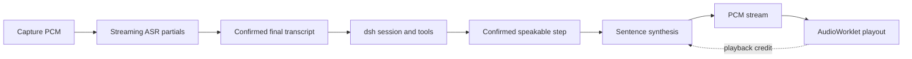

# Streaming voice runtime

## Boundaries and flow

Lares owns Voice Service orchestration; audio-engines owns inference and its
engine-spec v2 contract. Router owns identity, routing and usage; Model Console
proxies the discovered engine endpoints. No LiveKit Agent runtime is imported.

ASR runs during recording. Partials are replaceable display data, never prompts.
Capture flushes its tail and disconnects before sending ASR finish. The final
transcript then follows the existing dictation/Agent path exactly once. Dictation
still requires explicit completion and only appends to the originating draft.
A missing streaming ASR capability uses the existing recording/upload path;
a failed active stream is an explicit error, not an automatic second submission.

## Host and SDK

Authenticated `POST /api/lares/voice/stream/ticket` accepts `operation: stt|tts`
and returns a single-use, 30-second grant for `/api/lares/voice/stream`.
The grant binds owner, device, selected authorized model and a configuration
snapshot; upstream credentials never reach the client. Existing LarePass socket
protocol authentication is retained. Host/headset devices keep their existing
exclusive audio lease and playback path. The socket is one operation, not a new
business session or a parallel model directory.

Browser TTS receives a format message (PCM signed 16-bit little-endian mono and
actual sample rate), binary audio, then done. AudioWorklet resamples for the
output device and reports consumed source frames. Host scheduling limits pending
audio to approximately two seconds, with bounded transport and render buffers.
It starts the first confirmed sentence immediately, then synthesizes later
sentences while earlier audio plays. Non-streaming models retain explicit WAV
file playback. After output begins, errors do not replay or reroute the answer.

ASR uses 16 kHz mono PCM and partial/final messages. Capture and playback nodes,
streams, sockets, pending operations and output generations are cancelled on
pause, stop, session change and disposal. Stopping audio does not cancel dsh.
History and stale output generations cannot restart playback. Read-aloud keeps
the existing default off and respects explicit saved choices; off performs no
automatic synthesis.

## Safe overlap

Capture overlaps ASR; synthesis overlaps playout. In a tool-capable dsh step,
text is not known to be a final answer until the step settles. Therefore the
stream reader waits for a confirmed assistant message and suppresses reasoning,
tool-bearing or interrupted steps. It does not speculate about business results.
There is no unconditional LLM-token-to-TTS forwarding and no speculative tools.
A future explicit committed-speech contract may permit earlier final-answer
text, but absence of that contract is not treated as permission to speak it.

The external composite gateway also forwards synthesized chunks progressively,
converting from declared source rate to its existing 24 kHz wire contract.
No new external protocol or change in its rollout gate is introduced.

## Metrics and validation

Measure final ASR tail, LLM effective text latency, text-to-first-generated audio,
Host first delivered samples, client first rendered samples, underruns and
cancellation release. Headers, WAV headers and ready messages are not audio.
Compare identical text/model under matching conditions; report cold/warm/resource
queue conditions separately and do not claim stable P95 from three samples.

GPU-free tests cover early samples before completion, cancellation propagation,
one-use grants, explicit read-aloud off, ASR partial/final boundary, playback
buffer limits and sample-rate conversion. A browser lifecycle regression verifies
flush/disconnect precedes ASR finish and repeated cleanup closes its context once.
Real model transport checks do not substitute for physical microphone, audible
playback, echo, Bluetooth or packaged mobile-host acceptance.

## Observed shared-GPU bottleneck

The 2026-10-18 real-model baseline separates warmed TTS (~0.24–0.29 s to PCM)
from TTS immediately after a dsh response (~5.8–6.0 s). Correlated engine logs
show the latter waiting for the previous LLM client's HAMi GPU lease to expire
through inactivity. HTTP streaming cannot bypass that ownership boundary.

A follow-up scheduling change must coordinate request completion, GPU work
completion and lease release in the GPU runtime. Do not release from Router's
HTTP completion callback alone: output completion does not prove all kernels
have drained, and other requests may still be active. Do not disable the lock,
change global GPU mode, or reduce the idle interval without fairness, concurrent
request, cancellation and audio continuity tests. Record lease-wait separately
from first generated samples when evaluating that change.
